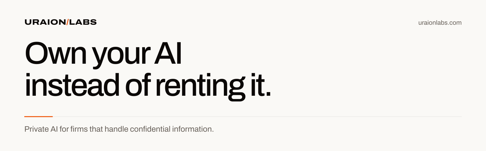

<picture>
  <source media="(prefers-color-scheme: dark)" srcset="https://raw.githubusercontent.com/UraionLabs/.github/main/profile/assets/profile-banner-dark.png">
  <source media="(prefers-color-scheme: light)" srcset="https://raw.githubusercontent.com/UraionLabs/.github/main/profile/assets/profile-banner-light.png">
  
</picture>

Uraion Labs is an AI company in Dallas, Texas. We set up private AI for firms that handle confidential information. The AI runs on a computer the firm owns. It is tested on the firm's real work and gets better every month from the team's corrections.

[Website](https://www.uraionlabs.com) · [How it works](https://www.uraionlabs.com/how-it-works) · [Results](https://www.uraionlabs.com/research) · [Hugging Face](https://huggingface.co/UraionLabs) · [Contact](https://www.uraionlabs.com/contact)

## How it works

1. **We test AI models on your work.** Your team gives us 50 to 100 real tasks with the right answers. You see how several models score before you buy anything.
2. **We install the best one in your office.** It runs on a computer you own and connects to your files. This takes about 30 days.
3. **Your team uses it and corrects it.** Each approval and fix is saved on your computer.
4. **We make it better every month.** We use those corrections to fix the most common mistakes. Each month you get a report on how it scores.
5. **We switch to a newer model only if it's better.** It has to score higher on your tasks, and you decide.

## What you own

The computer, the AI model, its test tasks, your team's corrections and every improvement. If you stop working with us, you keep all of it.

## Results

We train free AI models for one job and test them in public.

| Model | Result |
| --- | --- |
| [Uraion Cyber 1.0](https://huggingface.co/UraionLabs/Uraion-Cyber-V1.0) | Finds security problems in code. It got 90.2% of 1,145 unseen tasks right, against 79.7% for the free model it started from. |
| [Nemotron 3.5 Bolt, our version](https://huggingface.co/UraionLabs/Nemotron-3.5-Bolt-74B-A9B-24GB-Metal-GGUF) | Reads prompts 3.7 times faster than NVIDIA's original on a Mac with an M5 Pro chip. |

The full numbers, including what didn't improve, are on our [results page](https://www.uraionlabs.com/research). All of our free models are on [Hugging Face](https://huggingface.co/UraionLabs).

## Code

Most of our work runs on our clients' own computers, so most of it is private. Public tools and research code will appear here when we release them.

Issues and pull requests are welcome on public repositories. These organization defaults apply unless a repository has its own:

- [Contributing](https://github.com/UraionLabs/.github/blob/main/CONTRIBUTING.md)
- [Code of conduct](https://github.com/UraionLabs/.github/blob/main/CODE_OF_CONDUCT.md)
- [Security](https://github.com/UraionLabs/.github/blob/main/SECURITY.md)
- [Support](https://github.com/UraionLabs/.github/blob/main/SUPPORT.md)

## Contact

To talk about AI for your firm, [request a consultation](https://www.uraionlabs.com/contact). We work with firms across the US, and on site in Dallas-Fort Worth.
